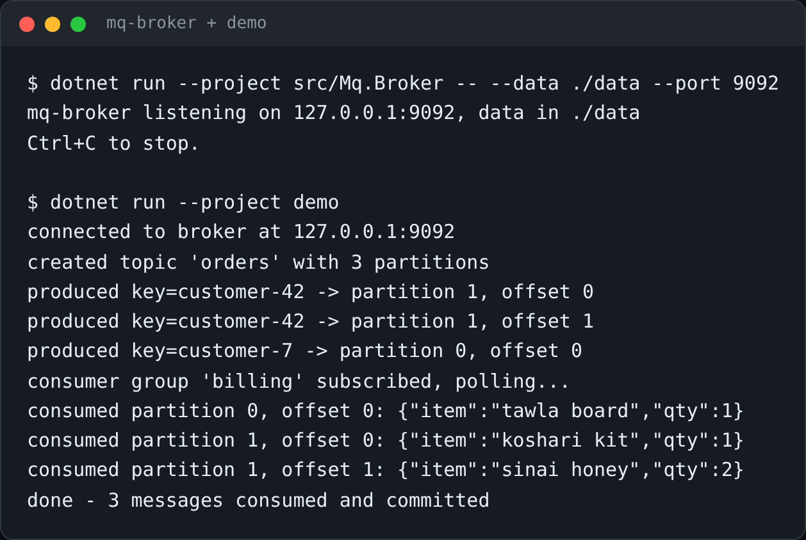
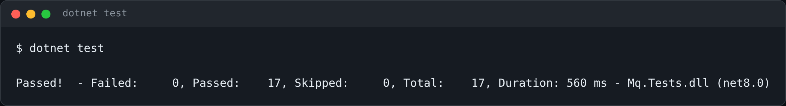

# message-queue-csharp

A log-based message queue built from scratch in C# on .NET 8 - a small,
honest "build your own Kafka": brokers keep topics split into **partitions**,
each partition is an append-only **segmented log** on disk, producers write
records over a **binary TCP protocol**, and consumers read in **groups** with
committed offsets.

No third-party runtime dependencies. The only NuGet packages are the test
framework.

```
producer ──► ┌────────────── broker ──────────────┐
             │  topic: orders                     │
             │  partition 0 │ offset 0..n │ .log  │
             │  partition 1 │ offset 0..n │ .log  │──► consumer group "billing"
             └──────────────────────────────────────┘     (committed offsets)
```

## Quick start

```bash
dotnet build MessageQueue.sln

# Start a broker (data lives in ./data)
dotnet run --project src/Mq.Broker -- --data ./data --port 9092
```

```csharp
using Mq.Client;

// Produce
using var connection = new MqConnection("127.0.0.1", 9092);
await connection.ConnectAsync();
var producer = new MqProducer(connection);
await producer.CreateTopicAsync("orders", partitions: 3);
ProduceResult result = await producer.SendAsync(
    "orders", key: Encoding.UTF8.GetBytes("customer-42"), value: Encoding.UTF8.GetBytes("{...}"));
// Keys are routed with FNV-1a, so one key always lands on one partition.

// Consume as part of the "billing" group
using var consumerConnection = new MqConnection("127.0.0.1", 9092);
await consumerConnection.ConnectAsync();
var consumer = new MqConsumer(consumerConnection, group: "billing");
await consumer.SubscribeAsync("orders");           // resumes from the group's committed offsets

IReadOnlyList<Message> batch = await consumer.PollAsync(maxRecords: 100);
foreach (Message message in batch)
    Console.WriteLine($"[{message.Topic}/{message.Partition}@{message.Offset}] {Encoding.UTF8.GetString(message.Value)}");
await consumer.CommitAsync(batch[^1]);             // a restarted consumer resumes after this point
```

A real run of exactly that:



## How it works

**Segmented log storage.** Each partition is a directory of segment files
(`00000000000000000000.log`, `00000000000000001281.log`, ...). A segment rolls
once it passes `MaxSegmentBytes` (64 MB by default). Every record is
length-prefixed and CRC-32 checksummed, so a torn write from a crash is
detected and truncated on recovery, never read back.

**Sparse offset index.** Each segment has a companion `.index` file: one
`(offset -> file position)` entry per 4 KB appended. A read binary-searches
the index, seeks close to the target, then scans forward record by record, so
reads stay O(log n) on disk size instead of scanning whole segments.

**Wire protocol.** Length-prefixed frames over TCP:
`[int32 length][int16 apiKey][int16 version][int32 correlationId][payload]`.
Six calls: `CreateTopic`, `ListTopics`, `Produce`, `Fetch`, `CommitOffset`,
`FetchOffset`. Payloads are hand-rolled little-endian binary, no serializer
dependency.

**Consumer groups.** The broker persists one JSON file of committed
`(group, topic, partition) -> offset` entries. Consumers in a group resume
from their last commit; different groups read the same partition
independently, so one topic feeds billing, analytics, and audit at their own
pace.

**Retention.** Size- and age-based (`RetentionBytes`, `RetentionMs`), applied
to whole segments from the oldest end. The active segment is never deleted.

## Guarantees and limits (it's v1)

- Ordering is per-partition, like Kafka. Across partitions there is none.
- Single broker, no replication. The log survives restarts and torn writes;
  it does not survive losing the disk.
- At-least-once delivery: commit offsets *after* processing. If you crash
  before committing, the records come back.
- Consumer groups share work by manual assignment (each consumer takes all
  partitions it subscribes) - run one consumer per group, or accept
  duplicates. Rebalancing is the obvious next step.

## Tests

```bash
dotnet test
```



17 tests cover the record codec (CRC corruption), segment rolling, sparse
index reads across segment boundaries, torn-tail recovery, retention, topic
management, and the full stack over loopback TCP: produce/consume round-trips,
group offset resume across consumer restarts, and broker-restart durability.

## Layout

```
src/Mq.Core       storage engine: records, CRC-32, segments, logs, partitions, topics
src/Mq.Protocol   wire framing and payload codecs
src/Mq.Broker     TCP broker + consumer-group offset store
src/Mq.Client     producer/consumer client library
tests/Mq.Tests    xunit: storage, topics, end-to-end over TCP
```
